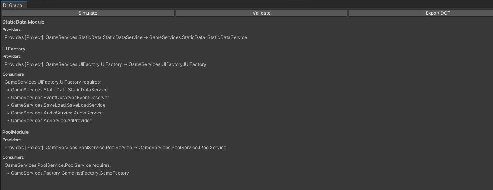
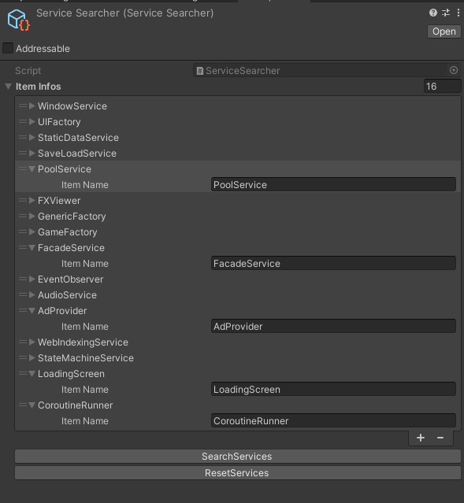

# Zenject Locator


An editor tool for Zenject that **auto-wires services** and **draws the dependency graph without entering Play Mode**.



## What it does

**Service locator and auto-binding**
- Finds every class that implements `IService` or `IModule` across the loaded assemblies.
- Keeps the found types in a `ScriptableObject` registry, so the list is visible and versioned.
- `BootInstaller` walks the registry and calls each type's static `InitializeService(DiContainer, Transform)` or `InitializeModule(DiContainer)`. New services are wired by adding the interface, with no installer edits.

**Dependency graph and DI simulation (Editor)**
- `Tools → DI → Graph` records every binding through a recording binder, without running the game.
- **Validate** reports incompatible contract/implementation pairs and consumers with no provider.
- **Export DOT** saves the graph for Graphviz (`dot -Tpng digraph.dot -o graph.png`).



## Setup

1. Mark your classes:
   ```csharp
   public class AudioService : IService
   {
       public static void InitializeService(DiContainer container, Transform parent)
       {
           container.Bind<AudioService>().AsSingle();
       }
   }
   ```
   Modules implement `IModule` with `public static void InitializeModule(DiContainer container)`. `[DiModule("Name")]` gives a module a readable name in the graph.
2. Create the registries: *Create → Zenject Locator → ServiceSearcher / ModuleSearcher*, then press **SearchServices** / **SearchModules** in the inspector.
3. Add `BootInstaller` to your `SceneContext` or `ProjectContext` and assign both registries.
4. Open `Tools → DI → Graph`, press **Simulate**, then **Validate**.

## How it works

| Part | Files |
|---|---|
| Type discovery and registry | `TypeSearchers/*`, `Editor/*SearcherEditor.cs` |
| Installation at startup | `Installer/BootInstaller.cs`, `Installer/TypeInitializer.cs` |
| Recording binder (real or recording) | `Bind/RecordingBinder.cs`, `Contracts/*` |
| Consumer scan (`[Inject]` constructors, fields, properties, methods) | `Scanner/InjectScanner.cs` |
| Graph, simulation, validation, DOT export | `DiGraph/*` |

## Requirements

Unity with Zenject / Extenject.

## License

MIT
